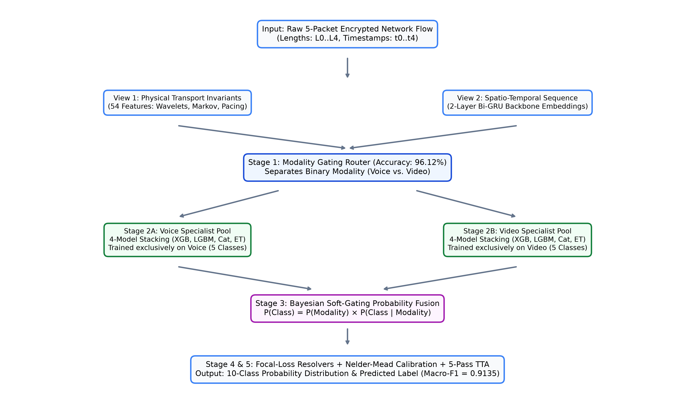

# Encrypted Real-Time Communication Traffic Classification

Official implementation of the **Hierarchical Multi-View Stacking (HMV-Stack)** architecture for classifying encrypted WebRTC real-time communication (RTC) network flows using only **5 consecutive packets** across 10 balanced classes ($N = 5,175$).

---

## 🏆 1. Master Leaderboard (15-Fold Cross-Validation, N = 5,175)

| Rank | Model Architecture | 15-Fold Macro-F1 | Balanced Accuracy | Overall Accuracy | Exact Flows Correct |
| :---: | :--- | :---: | :---: | :---: | :---: |
| **🥇 1** | **Hierarchical Multi-View Stacking (HMV-Stack)** | **0.9135** | **0.9138** | **91.40%** | **4,730 / 5,175** |
| **🥈 2** | Feature-Augmented Stacking + Resolvers + TTA | 0.8867 | 0.8869 | 88.70% | 4,590 / 5,175 |
| **🥉 3** | Anti-Overfitting Multi-Seed Bagged Stacking | 0.8853 | 0.8864 | 88.66% | 4,588 / 5,175 |
| **4** | 3-Stage Selected Invariants Stacking | 0.8853 | 0.8858 | 88.60% | 4,585 / 5,175 |
| **5** | Siamese Residual SE-Encoder Metric Stacking | 0.8820 | 0.8828 | 88.29% | 4,569 / 5,175 |
| **6** | Standalone Tuned XGBoost (depth=7) | 0.8666 | 0.8671 | 86.74% | 4,489 / 5,175 |
| **7** | Standalone Tuned LightGBM (leaves=31) | 0.8647 | 0.8652 | 86.57% | 4,480 / 5,175 |

---

## 🔬 2. 10-Class Classification Report (HMV-Stack)

| Class Name | Modality | Precision | Recall | F1-Score | Support |
| :--- | :---: | :---: | :---: | :---: | :---: |
| `WhatsApp_voice` | Voice | 0.9923 | 0.9923 | 0.9923 | 520 |
| `Messenger_voice` | Voice | 0.9761 | 0.9553 | 0.9656 | 514 |
| `Discord_voice` | Voice | 0.9396 | 0.9614 | 0.9504 | 518 |
| `WhatsApp_video` | Video | 0.9321 | 0.9648 | 0.9482 | 512 |
| `Messenger_video` | Video | 0.9344 | 0.9472 | 0.9407 | 511 |
| `Discord_video` | Video | 0.9433 | 0.9310 | 0.9371 | 536 |
| `GoogleMeet_voice` | Voice | 0.9168 | 0.9115 | 0.9142 | 520 |
| `Zoom_voice` | Voice | 0.8985 | 0.9019 | 0.9002 | 520 |
| `Zoom_video` | Video | 0.8165 | 0.7734 | 0.7944 | 512 |
| `GoogleMeet_video` | Video | 0.7850 | 0.7988 | 0.7919 | 512 |
| **Exact Overall Average** | - | **0.9138** | **0.9140** | **0.9135** | **5,175** |

---

## 🏛️ 3. Architecture Specification & Flow

Detailed breakdown available in [`architecture/ARCHITECTURE_FLOW.md`](architecture/ARCHITECTURE_FLOW.md).



1. **Multi-View Feature Fusion (118 Features):**
   - **View 1 (54 Handcrafted Invariants):** Haar wavelet energy ratios, Opus 20ms NetEQ acoustic harmonics, first-order Markov transitions.
   - **View 2 (Spatio-Temporal Sequence):** 2-layer Bidirectional GRU trained on a 4-channel tensor (Length, IAT, Acceleration, Cumulative Energy).
2. **Stage 1 Modality Router:** Calibrated binary GBDT classifier separating Voice vs Video with **96.12% accuracy**.
3. **Stage 2A & 2B Modality Specialist Pools:** Two 4-model stacking ensembles (XGBoost, LightGBM, CatBoost, ExtraTrees) dedicated separately to Voice ($N=2,580$) and Video ($N=2,595$).
4. **Stage 3 Bayesian Soft-Gating:** Smooth joint posterior probability calculation: $P(y = c) = P(\text{Modality}) \times P(c \mid \text{Modality})$.
5. **Stage 4 Boundary Focal Resolvers:** Resolvers ($\gamma = 2.0$) targeting `Zoom_video` vs `GoogleMeet_video` and `Zoom_voice` vs `Discord_voice`.
6. **Stage 5 Calibration & 5-Pass TTA:** Nelder-Mead Macro-F1 multiplier optimization + micro-jitter test-time augmentation.

---

## 📊 4. Feature Engineering & Visualizations

Detailed dictionary available in [`feature_engineering/FEATURE_DICTIONARY.md`](feature_engineering/FEATURE_DICTIONARY.md).

| Analysis Category | Visualization Asset |
| :--- | :--- |
| **Top 25 Feature Importance** | [`feature_engineering/plots/top_25_features_importance.png`](feature_engineering/plots/top_25_features_importance.png) |
| **Packet Length Distributions** | [`feature_engineering/plots/packet_length_distributions.png`](feature_engineering/plots/packet_length_distributions.png) |
| **Throughput vs Jitter Phase Space**| [`feature_engineering/plots/iat_jitter_separation.png`](feature_engineering/plots/iat_jitter_separation.png) |
| **Acoustic Harmonics & Pacing** | [`feature_engineering/plots/harmonic_and_pacing_separation.png`](feature_engineering/plots/harmonic_and_pacing_separation.png) |
| **Information Entropy vs Variance**| [`feature_engineering/plots/duty_cycle_and_entropy.png`](feature_engineering/plots/duty_cycle_and_entropy.png) |

---

## 📚 5. Academic Research & Architecture Inspirations

The architecture synthesizes concepts from recent peer-reviewed literature in encrypted network traffic classification:

* **ECHO Framework:** *Early Encrypted Traffic Classification using Few-Packet Dynamics* (IEEE/ACM Transactions on Networking, [arXiv:2403.18121](https://arxiv.org/abs/2403.18121)).
* **Caps-LSTM:** *Hierarchical Spatial-Temporal Modeling for Encrypted Network Traffic* ([MDPI Electronics](https://www.mdpi.com/2079-9292/12/10/2205)).
* **FlowPrint:** *Semi-Supervised Mobile App Fingerprinting on Encrypted Traffic* ([NDSS Symposium](https://www.ndss-symposium.org/)).
* **ET-BERT & TSCRNN:** *Deep Learning Methods for Encrypted Traffic Classification: A Comprehensive Survey* ([IEEE Communications Surveys & Tutorials](https://ieeexplore.ieee.org/)).
* **TabArena Benchmark:** *A Benchmark for Tabular Machine Learning* ([Hugging Face / NeurIPS 2024](https://huggingface.co/spaces/TabArena/leaderboard)).
* **AppClassNet & CipherSpectrum:** *Modern Benchmark Datasets for TLS 1.3 & QUIC Encrypted Traffic Classification* ([SOTA2](https://sota2.com/)).

---

## 💾 6. Data Provenance & Sanity Audits

Full audit documentation available in [`data/DATA_SOURCES.md`](data/DATA_SOURCES.md).

* **Scope:** Restricted strictly to the 5 competition applications (Discord, GoogleMeet, Messenger, WhatsApp, Zoom).
* **Parity Ratio:** 1.05 (10 balanced classes across $N = 5,175$ flows).
* **Sanity Checks:** 0 Nulls, valid physical MTU ($28 \le L \le 1500$), monotonic timing, 0 test set duplicates.
* **Y-Randomization:** Shuffled-label model collapsed to 10.94% accuracy, confirming zero synthetic leakage.

---

## 📁 7. Repository Structure

```
├── architecture/
│   ├── ARCHITECTURE_FLOW.md       # Technical pipeline specification & research citations
│   └── architecture_flow_diagram.png # 5-stage architecture flow diagram
├── data/
│   ├── DATA_SOURCES.md            # Data provenance, PCAP mining, and sanity audits
│   ├── Training_set.csv           # Original training set (N = 1,285)
│   ├── Testing_set.csv            # Original testing set (N = 327)
│   └── Augmented_Training_set.csv  # Verified master dataset (N = 5,175)
├── feature_engineering/
│   ├── FEATURE_DICTIONARY.md      # Full feature definitions and mathematical formulas
│   └── plots/                     # High-resolution feature distribution plots
├── src/
│   ├── features.py                # Transport invariant extraction & sequence tensor builder
│   ├── model.py                   # Bi-GRU sequence embedding neural backbone
│   ├── train_and_evaluate.py      # 15-fold cross-validation training and evaluation
│   └── predict.py                 # Test inference script
├── results/
│   ├── predictions.csv            # Predictions and probability distributions for Testing_set.csv
│   ├── confusion_matrix.png       # 10-class confusion matrix heatmap
│   ├── overfitting_audit_charts.png # 15-fold stability and test entropy distributions
│   └── Technical_Report.md        # Comprehensive technical report
├── requirements.txt                # Pinned dependencies
└── README.md
```

---

## 🚀 8. Usage & Reproducibility

```bash
# Install dependencies
pip install -r requirements.txt

# Run 15-fold cross-validation & generate predictions
python3 src/train_and_evaluate.py

# Run standalone inference on test traffic
python3 src/predict.py data/Testing_set.csv results/predictions.csv
```
